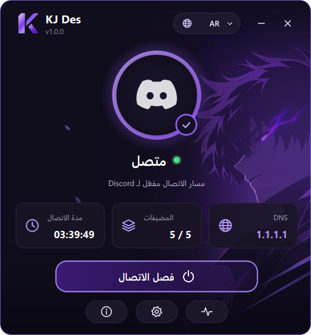
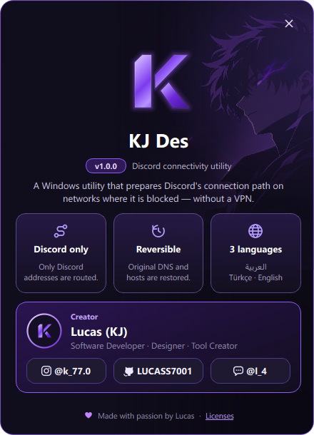

<div align="center">


# KJ Des

**A Windows desktop connectivity utility for Discord.**

Windows 10 / 11 · العربية · Türkçe · English · v1.0.3

</div>

---

## بالعربية

**KJ Des** أداة ويندوز تجهّز مسار اتصال Discord على الشبكات التي يُحجب فيها. اضغط **تفعيل الاتصال**، وانتظر حتى يتحقق البرنامج فعليًا من الوصول إلى Discord، ثم افتح Discord كالمعتاد.

- **ليست VPN:** لا تُخفي عنوان IP، ولا تُوجَّه إلا عناوين Discord المحددة.
- **كل التغييرات قابلة للاستعادة:** تُنسخ إعدادات DNS الأصلية احتياطيًا وتُستعاد كما هي تمامًا، ولا يُحذف من ملف hosts إلا الكتلة التي أضافها البرنامج.
- **«متصل» تعني متصلًا فعلًا:** لا تظهر الحالة إلا بعد مصافحة TLS ناجحة مع خوادم Discord عبر المسار.
- إغلاق النافذة لا يقطع الاتصال (يبقى في شريط المهام). استخدم **خروج** من قائمة شريط المهام لإنهاء البرنامج واستعادة الإعدادات.

## Türkçe özet

**KJ Des**, Discord'un engellendiği ağlarda bağlantı yolunu hazırlayan bir Windows aracıdır. VPN değildir; yalnızca Discord adresleri yönlendirilir. DNS'in orijinali yedeklenip aynen geri yüklenir, hosts dosyasında yalnızca KJ Des'in eklediği blok silinir. "Bağlandı" durumu, Discord'a gerçek bir TLS bağlantısı doğrulanmadan gösterilmez.

---

## Screenshots

Rendered from the real application UI with `scripts/render_preview.py`. The
connection state in these images is simulated (no network changes are made
while rendering).

<p align="center">
  
  
</p>

## Features

- One-click connection path for Discord on networks where it is blocked by
  SNI-based filtering (TLS ClientHello record fragmentation through a local relay).
- **Verified status:** "Connected" is shown only after a certificate-verified
  TLS handshake to `discord.com` succeeds through the relay.
- **Exact restoration:** original DNS configuration (static or automatic, IPv4
  and IPv6) is backed up and restored with read-back verification.
- **Hosts isolation:** only KJ Des's own marked hosts block is written and removed.
- Crash recovery on next start and, for the installed build, at Windows sign-in.
- Compact frameless window, system tray, live connection duration / hosts / DNS cards.
- Arabic (default, right-to-left), Turkish and English; switches instantly.
- Activity log of every network change (stored locally only).

KJ Des is **not a VPN**: it does not hide your IP address, does not provide
anonymity and does not route any other application's traffic.

## Requirements

- Windows 10 or Windows 11 (x64)
- Administrator rights (requested through UAC at start-up)
- For building: Python 3.10+ (tested with 3.14), optional
  [Inno Setup 6](https://jrsoftware.org/isinfo.php) for the installer

Runtime dependency: `PySide6-Essentials` (see `requirements.txt`).
Build/test dependencies: `pyinstaller`, `pytest` (see `requirements-dev.txt`).

## Installation

1. Download `KJDes-Setup-<version>.exe` from this repository's Releases page
   *(no public release has been published yet)*.
2. Optionally compare its SHA-256 with the published `.sha256` file.
3. Run the installer. KJ Des installs to `C:\Program Files\KJ Des`.
4. Start **KJ Des**, press **Enable connection**, then open Discord as usual.

The install location matters: the sign-in recovery task may only point to a
verified executable in Program Files. A copy started from elsewhere opens, but
refuses to connect rather than leaving routing without a crash cleaner.

> The executable is not code-signed yet, so Windows SmartScreen may show
> "Unknown publisher".

## Building from source

```powershell
powershell -ExecutionPolicy Bypass -File scripts\build.ps1
```

This runs the tests, regenerates the icons, builds `dist\KJDes\KJDes.exe`
(PyInstaller one-folder, windowed, UAC manifest, version resource), runs the
packaged `--self-test`, and — if Inno Setup is installed — produces
`installer\KJDes-Setup-<version>.exe` and its SHA-256 file.

Manual steps:

```powershell
python -m venv .venv
.venv\Scripts\python -m pip install -r requirements-dev.txt
.venv\Scripts\python packaging\make_icon.py
.venv\Scripts\python -m PyInstaller --noconfirm --clean packaging\KJDes.spec
ISCC.exe packaging\KJDes.iss
```

### Running from source

```bat
scripts\run_dev.bat
```

`--source-dev` skips the installed-recovery-target requirement (after a hard
crash the hosts block is cleaned on the next start instead of at sign-in).
`--no-elevate` opens the UI without administrator rights; connecting then fails
with a permission error — nothing is simulated.

### Tests

```powershell
$env:QT_QPA_PLATFORM = "offscreen"
.venv\Scripts\python -m pytest -q
```

All destructive operations are replaced by in-memory fakes (`tests/fakes.py`);
hosts tests use temporary files. The tests never modify the machine's DNS,
hosts file or scheduled tasks. Installer tests that compile Pascal code run
only when Inno Setup is installed.

## Safety and restoration behaviour

| Change while connected | Purpose | How it is undone |
|---|---|---|
| DNS of active adapters → Cloudflare `1.1.1.1` | consistent resolution of Discord names | The original configuration is backed up to an ACL-protected `%ProgramData%\KJ Des` file **before** any change and restored exactly; the backup entry is removed only after the restored settings are read back and verified. |
| Marked hosts block for `discord.com`, `updates.discord.com`, `gateway.discord.gg`, `cdn.discordapp.com`, `media.discordapp.net` → `127.0.0.1` | sends only these names to the local relay | Only the block between KJ Des's own markers is removed; every other line is preserved byte-for-byte. |
| Local relay on `127.0.0.1:443` | resolves the real IP over certificate-verified DoH and forwards the ClientHello in small TLS records | Stops on disconnect / exit. |

- Nothing is changed until secure DoH works, port 443 is free and a crash-safe
  DNS backup is persisted. Any failure after a change rolls everything back.
- A watchdog (only while connected) restores everything if the relay stops or
  another program removes the routing.
- After a crash or forced termination, the next start restores DNS and removes
  the hosts block; the installed build also registers a sign-in task
  (`KJDesHostsFailsafe`) that exists only while routing is active.
- **Settings → Restore defaults** can be used at any time.
- The relay never decrypts traffic; after the first packet it is a plain TCP
  tunnel and accepts only the five Discord names above.
- KJ Des never reads or changes other applications' hosts blocks, scheduled
  tasks, data folders or uninstall registry entries.
- Every network modification is written to the local Activity log
  (`%APPDATA%\KJ Des\kjdes.log`, size-capped, never uploaded).

## Troubleshooting

| Message / symptom | What to do |
|---|---|
| *KJ Des must be installed (Program Files) to connect safely* | Install with the setup program; portable copies cannot register the crash-recovery task. |
| *Port 443 is used by another program* | Another bypass tool (for example GoodbyeDPI, Zapret, WARP or DPort) is active. Close it and try again. Nothing was changed. |
| *Secure DNS is unreachable on this network* | DoH to Cloudflare/Google is blocked on this network. Nothing was changed. |
| *The hosts file is locked* | Usually antivirus "hosts protection". Allow KJ Des or try again a moment later. |
| *Some settings could not be restored* | Open **Settings → Restore defaults**. Details are in **Activity**. |
| The uninstaller says KJ Des has not finished restoring | Open KJ Des once — it restores leftovers automatically at start — then uninstall again. |
| Another tool's uninstaller refuses to run while KJ Des is connected | Some tools treat any `127.0.0.1 discord.com` hosts line as their own. Disconnect KJ Des (or open it once after a crash), then retry. |
| Discord does not connect after KJ Des was killed | Start KJ Des once; its start-up recovery removes its routing and restores DNS. |

## Project structure

```
app/
├── main.py                 entry point: --cleanup-hosts, single instance, UAC, Qt start
├── branding.json           creator name and social links shown in About
├── core/
│   ├── connection.py       ConnectionManager — connect / verify / restore / watchdog
│   ├── recovery.py         DNS backup and exact restore (protected store)
│   ├── system_ops.py       the only OS boundary (replaced by fakes in tests)
│   ├── discord_unblock.py  relay, TLS fragmentation, DoH, hosts block
│   ├── dns_manager.py      locale-independent DNS snapshot / restore
│   ├── failsafe.py         verified sign-in recovery task
│   ├── secure_store.py     ACL-protected %ProgramData% store
│   └── adapter_manager.py, log_manager.py, config_manager.py, paths.py, …
├── security/               elevation, single instance (mutex + IPC handshake)
├── services/               localization, validated settings, branding
├── ui/                     window, About, dialogs, tray, icons, styles.qss
├── locales/                ar.json · tr.json · en.json
└── assets/                 icons, Inter font, artwork
packaging/                  KJDes.spec (PyInstaller), KJDes.iss (Inno Setup), make_icon.py
scripts/                    build.ps1, run_dev.bat, render_preview.py
tests/                      automated tests (no real network changes)
```

The creator name and links in the About dialog come from `app/branding.json`
(only `https://` links are accepted); all user-visible text comes from
`app/locales/*.json`.

## Known limitations

- Not every network can be unblocked by TLS record fragmentation.
- Discord voice servers (`*.discord.media`) are not routed; they were not
  blocked in the original measurements.
- The executable is not code-signed. There is no automatic updater yet.

## License

KJ Des is proprietary software and is not released under an open-source license. All rights are reserved. See [LICENSE](LICENSE).

Third-party components and inherited code remain subject to their respective copyright notices and license terms. See [NOTICE.md](NOTICE.md) and the [licenses/](licenses/) directory.

Discord is a trademark of Discord Inc. KJ Des is not affiliated with, sponsored by, or endorsed by Discord Inc.

## Maintainer

**Lucas** — developer and publisher of KJ Des

- GitHub: [@LUCASS7001](https://github.com/LUCASS7001)
- Instagram: [@k_77.0](https://www.instagram.com/k_77.0/)
- Discord: `@l_4`

Bug reports and feature requests: use this repository's issue tracker.
Security issues: see [SECURITY.md](SECURITY.md).
